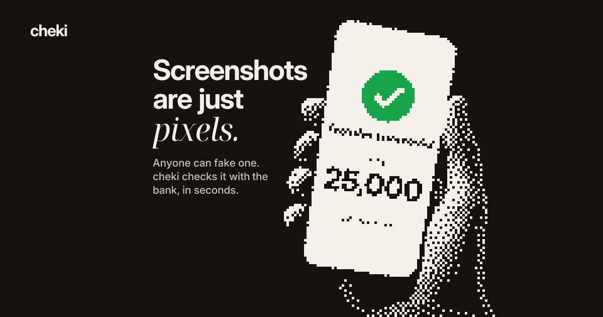
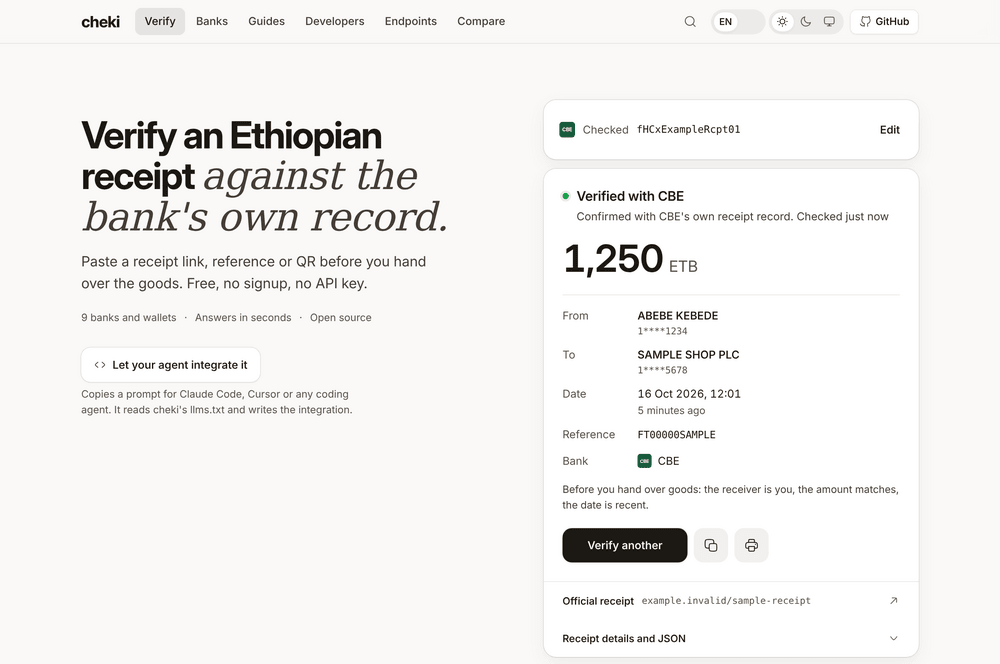
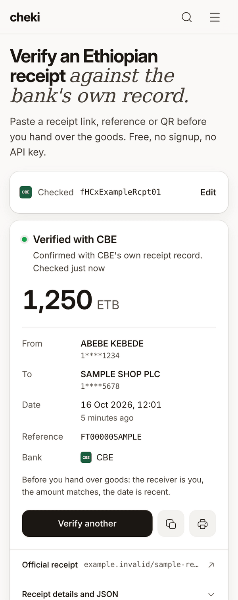
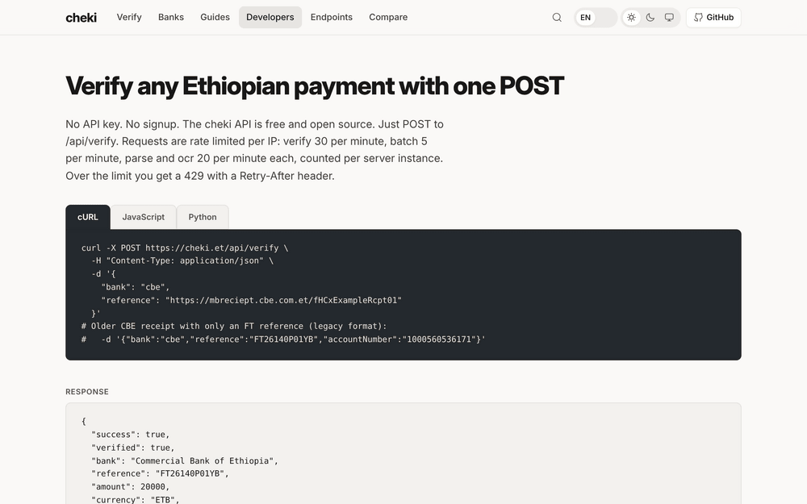

<p align="center">
  <a href="https://cheki.et"></a>
</p>

# cheki

**Check an Ethiopian bank or mobile money receipt with the bank that issued it. Free, open source, no signup, no API key.**

[](https://github.com/1RB/cheki/actions/workflows/ci.yml)
[](https://www.npmjs.com/package/cheki-verify)
[](https://pypi.org/project/cheki/)
[](LICENSE)
[](https://github.com/1RB/cheki/stargazers)

A screenshot of a receipt is only pixels. cheki takes the link, reference, QR code or screenshot from a receipt, asks the bank's own public receipt endpoint for that transaction, and shows what the bank says. Use it at [cheki.et](https://cheki.et), call the REST API, or use an SDK.

## Screenshots

<a href="https://cheki.et">
  <picture>
    <source media="(prefers-color-scheme: dark)" srcset="docs/assets/verify-desktop-dark.png">
    
  </picture>
</a>

<table>
  <tr>
    <td width="36%" valign="top">
      <picture>
        <source media="(prefers-color-scheme: dark)" srcset="docs/assets/verify-phone-dark.png">
        
      </picture>
    </td>
    <td width="64%" valign="top">
      <a href="https://cheki.et/developers"></a>
    </td>
  </tr>
  <tr>
    <td>Phone, 390px</td>
    <td>API docs at <a href="https://cheki.et/developers">cheki.et/developers</a></td>
  </tr>
</table>

The receipt in these screenshots is made up. The verify call was answered with a mocked response, so no real payment, name or account appears. The images follow your GitHub light or dark theme.

## Contents

[How it works](#how-it-works) · [Supported banks](#supported-banks) · [Quick start](#quick-start) · [SDKs](#sdks) · [API](#api) · [Self-hosting and development](#self-hosting-and-development) · [Contributing](#contributing) · [Security](#security) · [License](#license)

## How it works

1. **You give cheki what is on the receipt:** the share link, the reference, the QR code, or a screenshot (cheki reads the reference out of it).
2. **cheki asks the bank.** It fetches the receipt from the bank's own public endpoint and parses the JSON, HTML or PDF that comes back.
3. **You get the bank's answer.** A result is green only when the bank confirmed the receipt (`verified: true` in the API). Nothing else is shown as verified:
   - a reference the bank does not know, or a bank that did not answer
   - a BOA QR code the bank could not confirm (`verified: false, decodedOnly: true`)
   - receipt text you pasted, or a page sent by the bookmarklet (`parsed: true, source: "client-supplied"`): cheki can read it, but the bank did not confirm it

Telebirr and M-Pesa only answer Ethiopian IP addresses, and the hosted API does not run in Ethiopia. For those, cheki.et offers to open the receipt in your own browser and paste it back (or send it with the bookmarklet); that result is read, never verified. To verify them, self-host on an Ethiopian IP.

Confirmed results are cached in memory for 6 hours, so checking the same receipt again returns `cached: true` without another bank request. Failures are never cached.

## Supported banks

**10 live banks** (three in beta) and 21 in research. The source of truth is [`src/lib/manifest/banks.json`](src/lib/manifest/banks.json); `GET /api/banks` returns it, including each bank's receipt formats, current first.

| Bank | `id` | What to send | Notes |
|------|------|--------------|-------|
| Commercial Bank of Ethiopia | `cbe` | Receipt ID or receipt link (`mbreciept.cbe.com.et/…`, also in the app's QR code) | Older receipts with only an FT reference also need the last 8 digits of the receiving account |
| Telebirr | `telebirr` | Transaction number, or the Payment QR code on the receipt | Ethiopian IPs only |
| Bank of Abyssinia | `boa` | Slip link, or reference + last 5 digits of the account on the receipt; receipt QR for inter-bank transfers | |
| M-Pesa Ethiopia | `mpesa` | Transaction number | Beta. Ethiopian IPs only |
| Dashen Bank | `dashen` | FT Ref (16 letters and digits) | Old Dashen Super App links are read for their FT Ref |
| Awash Bank | `awash` | Share link from the SMS | |
| Siinqee Bank | `siinqee` | eBirr receipt link (`receipt.ebirr.com/siinqee/…`) | Newer `receipts.siinqeebank.com` links are not supported yet |
| eBirr | `ebirr` | Receipt link (`receipt.ebirr.com/{tenant}/{token}`) | Also reads eBirr links issued for Nib, Wegagen, Ahadu and KAAFI |
| ZamZam Bank | `zamzam` | Receipt link (`receipt.zamzambank.com.et/receipt/…`) or its numeric id | Beta |
| CBE Birr | `cbebirr` | Receipt number (TID, e.g. `DTS41AB2C90`) + the payer's phone number | Beta. An empty page back usually means the number and phone don't match |

Beta means the bank is live but not yet confirmed with enough real receipts. [cheki.et/endpoints](https://cheki.et/endpoints) shows every format with a dated changelog, and [cheki.et/status](https://cheki.et/status) shows the daily endpoint health check.

<details>
<summary>In research (21)</summary>

Zemen Bank has a parser and is waiting on a confirmed real receipt. The others need a receipt and an endpoint: Nib, Wegagen, Ahadu, KAAFI, Abay, Addis International, Amhara, Berhan, Bunna, Enat, Global Bank Ethiopia, Lion International, Oromia International, Hibret, Hijra, Shabelle, Goh Betoch, Tsedey, Gadaa, Rammis.

</details>

<details>
<summary>Where cheki reads each bank</summary>

| Bank | Endpoint | Answer |
|------|----------|--------|
| CBE | `https://mb.cbe.com.et/api/v1/transactions/public/transaction-detail/{RECEIPT_ID}` | JSON |
| CBE (legacy FT receipts) | `https://apps.cbe.com.et:100/?id={FT_REFERENCE}{LAST_8_DIGITS}` (often unreachable) | PDF |
| Telebirr | `https://transactioninfo.ethiotelecom.et/receipt/{REFERENCE}` | HTML |
| BOA | `https://cs.bankofabyssinia.com/api/onlineSlip/getDetails/?id={REFERENCE}{LAST_5_DIGITS}` | JSON |
| M-Pesa | `https://m-pesabusiness.safaricom.et/api/receipt/getReceipt?trxNo={REFERENCE}` | JSON envelope holding a base64 PDF |
| Dashen | `https://receipts.dashenbanksc.com/receipt/{FT_REF}` | HTML |
| Awash | `https://awashpay.awashbank.com:8225/-{TOKEN}` (the share link) | HTML |
| Siinqee | `https://receipt.ebirr.com/siinqee/{TOKEN}` | HTML |
| eBirr | `https://receipt.ebirr.com/{TENANT}/{TOKEN}` | HTML |
| ZamZam | `https://receipt-backend.zamzambank.com.et/api/v1/invoice/{RECEIPT_ID}` | JSON |
| CBE Birr | `https://cbepay1.cbe.com.et/aureceipt?TID={RECEIPT_NUMBER}&PH={PAYER_PHONE}` | PDF |

- **M-Pesa** is geo-blocked and has not been probed by cheki: the envelope shape comes from five other open-source verifiers, and the tests use a synthetic receipt. It stays in beta until a real receipt verifies.
- **ZamZam**'s service expects an HTTP Basic credential that ZamZam ships in its own public receipt web app (the same precedent as BOA's public QR key). cheki sends it from the parser and never returns it. The record carries the full account number, which cheki masks (first digit and last 4) before any output or cache.
- **CBE Birr** was verified on 2026-10-16 against two real receipts; the tests use a synthetic PDF with the same layout. The PDF prints the payer's and receiver's phone numbers in full, which cheki masks (09****1234). A receipt number and phone that don't match return an empty "Auto Receipt" page, which cheki reports as could not confirm, never as fake.

</details>

## Quick start

### On the web

Open [cheki.et](https://cheki.et) and paste a receipt link or reference, scan the QR code, or drop in a screenshot. No account needed.

### With curl

```bash
curl -X POST https://cheki.et/api/verify \
  -H "Content-Type: application/json" \
  -d '{"bank":"cbe","reference":"https://mbreciept.cbe.com.et/fHCxExampleRcpt01"}'
```

<details>
<summary>Response (illustrative values from the shared test fixtures)</summary>

```json
{
  "success": true,
  "verified": true,
  "bank": "Commercial Bank of Ethiopia",
  "bankCode": "cbe",
  "reference": "FT26140P01YB",
  "amount": 1250.5,
  "currency": "ETB",
  "senderName": "ABEBE KEBEDE",
  "senderAccount": "1****6171",
  "receiverName": "TIGIST ALEMU",
  "receiverAccount": "1****4321",
  "date": "2026-10-01",
  "cached": false
}
```

A `200` with `verified: false` is not a confirmed receipt. Only `verified: true` is.

</details>

### With an SDK

```ts
import { Cheki, isVerified } from "cheki-verify";

const cheki = new Cheki();
const result = await cheki.verify("cbe", "https://mbreciept.cbe.com.et/fHCxExampleRcpt01");
if (isVerified(result)) console.log(result.amount, result.senderName);
```

Call it from a server: the hosted `/api/verify` routes do not send CORS headers.

## SDKs

Five SDKs wrap the same REST API, all at the same version. Every SDK test suite decodes one shared set of response fixtures ([`sdks/fixtures/api-contract.json`](sdks/fixtures/api-contract.json)), and CI checks those fixtures against the real route handlers.

| Language | Package | Install | Version |
|----------|---------|---------|---------|
| TypeScript (Node 20+) | [`cheki-verify`](https://www.npmjs.com/package/cheki-verify) | `npm install cheki-verify` | [](https://www.npmjs.com/package/cheki-verify) |
| Python (3.10+) | [`cheki`](https://pypi.org/project/cheki/) | `pip install cheki` | [](https://pypi.org/project/cheki/) |
| Go (1.21+) | [`github.com/1RB/cheki/sdks/go`](https://pkg.go.dev/github.com/1RB/cheki/sdks/go) | `go get github.com/1RB/cheki/sdks/go` | [](https://pkg.go.dev/github.com/1RB/cheki/sdks/go) |
| Dart (3.4+) | [`cheki`](https://pub.dev/packages/cheki) | `dart pub add cheki` | [](https://pub.dev/packages/cheki) |
| PHP (8.1+) | [`cheki/cheki`](https://packagist.org/packages/cheki/cheki) | `composer require cheki/cheki` | [](https://packagist.org/packages/cheki/cheki) |

The TypeScript SDK is also on GitHub Packages as [`@1rb/cheki-verify`](https://github.com/1RB/cheki/pkgs/npm/cheki-verify). Each SDK has its own README under [`sdks/`](sdks) ([`python/`](python) for Python).

<details>
<summary>What every SDK does the same way</summary>

- **`verified` is the only success signal.** Each SDK has a helper: `isVerified()`, `is_verified`, `IsVerified()`.
- **QR codes go in `qrData`:** a BOA inter-bank receipt QR (bank `boa`) or the Payment QR code on a Telebirr receipt (bank `telebirr`). The server reads the reference out of the QR and checks it with the bank; a QR on its own never verifies.
- **Banks are identified by `id`** (`code` is kept as a deprecated alias). `beta` is true for M-Pesa, ZamZam and CBE Birr today. Results carry `orderId` when the receipt has one (CBE Birr).
- **Batch: at most 20 receipts**, checked before sending. Send long lists in chunks of 15 or fewer (`RECOMMENDED_BATCH_CHUNK`): every receipt also counts toward the verify limit, the whole batch has 60 s on the server, and a batch is never retried.
- **Typed errors** for 429 (with the `Retry-After` seconds) and 413, and the server's `error` text and `fallbackUrl` (geo-blocked banks) on every API error.
- **Timeouts and retries:** each attempt waits up to 65 s. At most one retry, and only where it is safe: `GET` requests on a network error or 5xx; verify on a network error or a 429/503 with a `Retry-After` of 60 s or less; a batch only on a 429/503 with a short `Retry-After`. The server makes at most 2 attempts per bank fetch, so one SDK call reaches a bank at most 4 times.
- **`getReceiptUrl`** builds `/api/receipt` links for CBE, Dashen, Zemen and ZamZam only. A CBE Receipt ID needs no account; a legacy CBE FT reference needs the receiving account.

</details>

<details>
<summary>Python</summary>

```python
from cheki import ChekiClient

cheki = ChekiClient()
result = cheki.verify("cbe", "https://mbreciept.cbe.com.et/fHCxExampleRcpt01")
# Older receipt, FT reference only: cheki.verify("cbe", "FT26140P01YB", account_number="1000560536171")
print(result.is_verified, result.amount, result.sender_name)
```

`verify()` returns a result for API errors too: check `result.http_status`, `result.error`, and `result.is_rate_limited` / `result.retry_after`. The old direct mode (`from cheki import verify`, which fetches banks from your machine) is deprecated and will be removed in the next major version; self-host the server instead.

</details>

<details>
<summary>Go</summary>

```go
client := cheki.NewClient()
result, err := client.Verify(ctx, cheki.VerifyOptions{
    Bank:      "cbe",
    Reference: "https://mbreciept.cbe.com.et/fHCxExampleRcpt01",
})
if err == nil && result.IsVerified() {
    fmt.Println(result.Amount, result.SenderName)
}
// errors.Is(err, cheki.ErrRateLimited); errors.As(err, &apiErr) for StatusCode, Message, RetryAfter, FallbackURL
```

</details>

<details>
<summary>Dart</summary>

```dart
final client = ChekiClient();
final result = await client.verify(
  bank: 'cbe',
  reference: 'https://mbreciept.cbe.com.et/fHCxExampleRcpt01',
);
print(result.isVerified);
client.close();
```

</details>

<details>
<summary>PHP</summary>

```php
use Cheki\ChekiClient;

$client = new ChekiClient();
$result = $client->verify('cbe', 'https://mbreciept.cbe.com.et/fHCxExampleRcpt01');
if ($result->isVerified()) {
    echo "$result->senderName sent $result->amount $result->currency";
} elseif ($result->isRateLimited()) {
    echo "retry in {$result->retryAfter} s";
}
```

</details>

### CLI

The Python package installs `cheki-verify`, which calls the hosted API:

```bash
pip install cheki
cheki-verify cbe https://mbreciept.cbe.com.et/fHCxExampleRcpt01
```

A clone of this repo also has a Node CLI that runs the verifier locally (`info`, `verify`, `verify-qr`, `health`). Don't use `npx cheki`: the npm package named `cheki` is an unrelated project.

```bash
npm run cli -- verify cbe https://mbreciept.cbe.com.et/fHCxExampleRcpt01
npm run cli -- verify telebirr DET8FJGUJ4
npm run cli -- health
```

### Coding agents

[`llms.txt`](https://cheki.et/llms.txt) describes the API for language models, and the home page has a "Let your agent integrate it" button that copies a ready prompt for Claude Code, Cursor or any coding agent. There is no MCP server.

## API

Base URL `https://cheki.et`. No authentication. Full reference: [cheki.et/docs](https://cheki.et/docs); SDK guides: [cheki.et/developers](https://cheki.et/developers).

| Endpoint | What it does |
|----------|--------------|
| [`POST /api/verify`](https://cheki.et/docs#verify) | Verify one receipt. Body: `bank`, and `reference` or `qrData`; `accountNumber` for BOA and legacy CBE; `phoneNumber` for CBE Birr |
| [`POST /api/verify/batch`](https://cheki.et/docs#batch) | Verify up to 20 receipts: `{ "receipts": [...] }`. Returns `results`, `total`, `verified`, `failed`, `cached` |
| [`GET /api/banks`](https://cheki.et/docs#banks) | Every bank with its `id`, status, `beta` flag and receipt `formats` |
| [`GET /api/health`](https://cheki.et/docs#health) | Per-bank reachability, cached up to 5 minutes |
| [`GET /api/receipt`](https://cheki.et/docs#receipt) | Open the bank's own copy of a receipt (`bank`, `reference`, `account`) for CBE, Dashen, Zemen and ZamZam |
| `POST /api/parse` | Read receipt text you pasted, or a page sent by the bookmarklet. Never verified |
| `POST /api/ocr` | Read a receipt screenshot (image up to 10 MB) |

**Rate limits** are per IP and per server instance: verify 30/min, batch 5/min (each receipt in a batch also counts toward verify), parse and ocr 20/min each. Over the limit the API answers `429` with a `Retry-After` header. Self-host for more.

**Errors** are JSON with `success: false` and an `error` message: `400` bad input, `404` unsupported bank, `413` body too large, `422` the bank does not know the receipt, `429` rate limited, `502` with a `fallbackUrl` when a geo-blocked bank cannot be reached. See [cheki.et/docs#errors](https://cheki.et/docs#errors).

## Self-hosting and development

Run your own copy with Docker (on an Ethiopian IP this also reaches Telebirr and M-Pesa):

```bash
git clone https://github.com/1RB/cheki.git
cd cheki
docker compose up -d        # serves on http://localhost:3000
```

For development you need Node 20+:

```bash
npm install
npm run dev                 # http://localhost:3000
```

<details>
<summary>Environment variables</summary>

All are optional.

| Variable | Default | What it does |
|----------|---------|--------------|
| `CHEKI_CACHE` | on | Set to `off` to disable the in-memory cache of confirmed results |
| `CHEKI_CACHE_TTL_MS` | `21600000` (6 h) | How long a confirmed result stays cached |
| `CHEKI_CACHE_MAX_ENTRIES` | `1000` | Cache size |
| `TELEGRAM_BOT_TOKEN`, `TELEGRAM_CONTRIB_CHAT_ID` | unset | Where `/api/contribute` (the "help us add a bank" form) forwards submissions; without them the form is disabled |
| `OG_VARIANT` | `current` | Which social card design to render |

</details>

<details>
<summary>npm scripts</summary>

| Script | What it does |
|--------|--------------|
| `npm run dev` / `build` / `start` | Next.js dev server, production build, production server (`build` first downloads the Tesseract OCR data) |
| `npm test` | Vitest, once (`test:watch`, `test:coverage` also exist) |
| `npm run lint` | ESLint |
| `npm run cli -- <command>` | The local CLI |
| `npm run probe -- <receipt-url>` | Test a receipt on your own machine without sending it anywhere (`--redact` masks names and accounts) |
| `npm run health-check` | The daily endpoint check that writes `public/status.json` |
| `npm run smoke -- <base-url>` | Smoke test a running deployment |
| `npm run link-audit -- <base-url>` | Check every sitemap page has an in-content inbound link |
| `npm run indexnow` | Ask IndexNow engines to recrawl after a production deploy |

</details>

Before opening a PR, run what CI runs for the web app:

```bash
npm run lint
npx tsc --noEmit
npx vitest run
npm run build
```

CI also builds and tests each SDK (Go, PHP, Dart, Python) and checks that every package version matches.

<details>
<summary>Releasing</summary>

Only `main` deploys to cheki.et; deploying never needs a tag. Every package (web app and all five SDKs) carries the same version, and `tests/sdk/version-sync.test.ts` fails CI if one drifts.

1. On a branch, run `./scripts/bump-version.sh --files-only X.Y.Z`, add a `## X.Y.Z` entry to `CHANGELOG.md` and `sdks/dart/CHANGELOG.md`, and merge the PR.
2. On the merged `main`, run `./scripts/bump-version.sh --tag-only X.Y.Z`. It tags `vX.Y.Z` and `sdks/go/vX.Y.Z` and pushes both.
3. The `vX.Y.Z` tag runs the publish workflow: npm (trusted publishing over GitHub OIDC, with provenance, no token), GitHub Packages, PyPI, Packagist and pub.dev, and it warms the Go module proxy.

The deploy checklist, smoke test, rollback steps and registry details are in [docs/RELEASING.md](docs/RELEASING.md).

</details>

### Analytics

cheki.et counts anonymous page views with [Vercel Web Analytics](https://vercel.com/docs/analytics/privacy-policy): no cookies and no personal identifier. Before an event leaves the browser, [`src/lib/analytics/url.ts`](src/lib/analytics/url.ts) reduces its URL to one of cheki's page paths with the query string and `#` part removed, never counts `/api` or `/dashboard`, and drops any address that is not a cheki page, so no receipt reference, link or account number is sent. A self-hosted copy outside Vercel records nothing.

## Contributing

The most useful contribution is a bank. If yours is not live, send a receipt link or a screenshot with the QR code through the private form on the bank's page at [cheki.et/banks](https://cheki.et/banks), or open a [bank request](https://github.com/1RB/cheki/issues/new?template=bank-request.yml) if you are happy to share it publicly (issues are public, so leave out names and account numbers). No code needed; [the contribution guide](https://cheki.et/guides/contribute-new-bank) explains what helps.

To write the parser yourself, follow [Adding or fixing a bank](CONTRIBUTING.md#adding-or-fixing-a-bank) in CONTRIBUTING.md: probe your receipt locally, add the manifest entry and parser, and add a redacted fixture with a test. Never commit an unredacted receipt.

Bugs and questions go in [issues](https://github.com/1RB/cheki/issues): include the bank, the kind of input, and what you expected.

### Security

Please don't put security details in a public issue. Message the maintainer, Ray ([@1RB](https://github.com/1RB) on GitHub), privately through the [Telegram bot](https://t.me/raysterminalbot), or open an issue that only asks for a private channel. See [cheki.et/contact](https://cheki.et/contact#security).

## License

[MIT](LICENSE). cheki is not affiliated with any Ethiopian bank or wallet. It reads publicly accessible receipt endpoints, and every verified result comes from the bank's own system.
